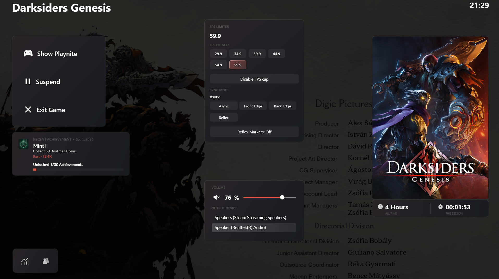
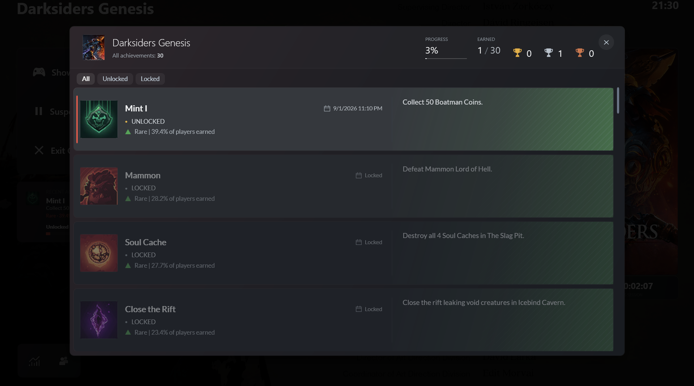
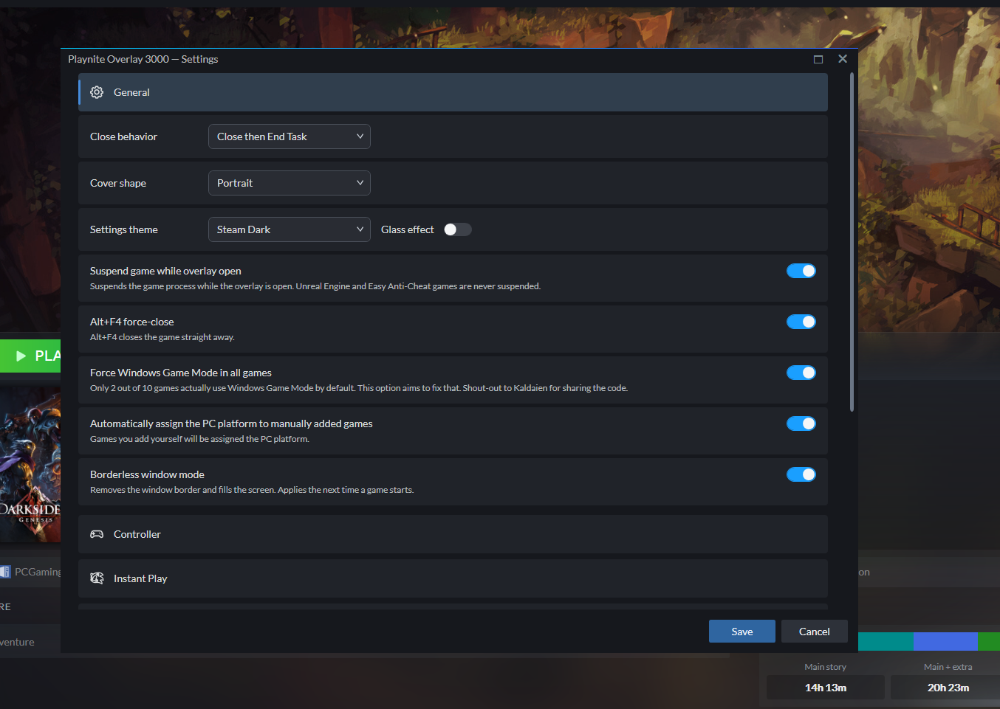
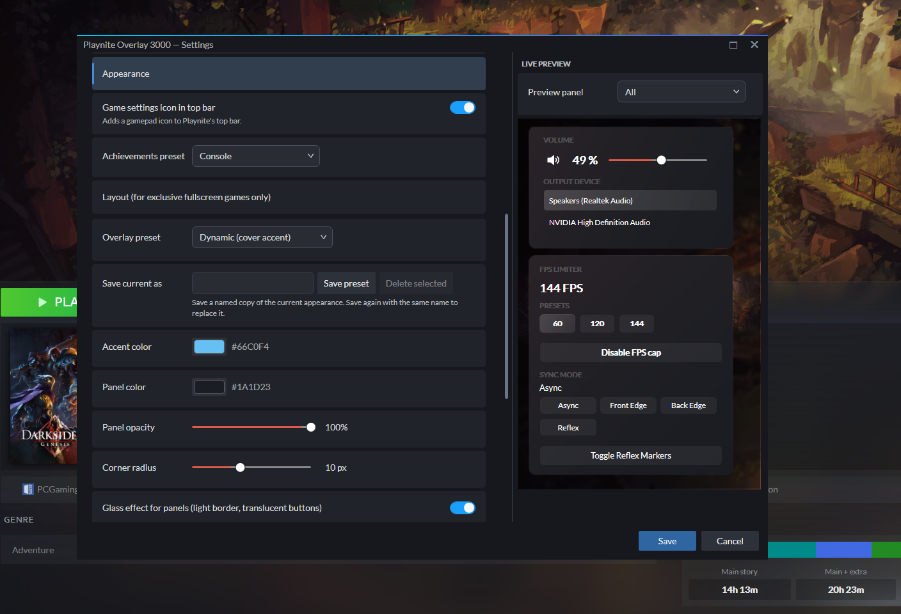
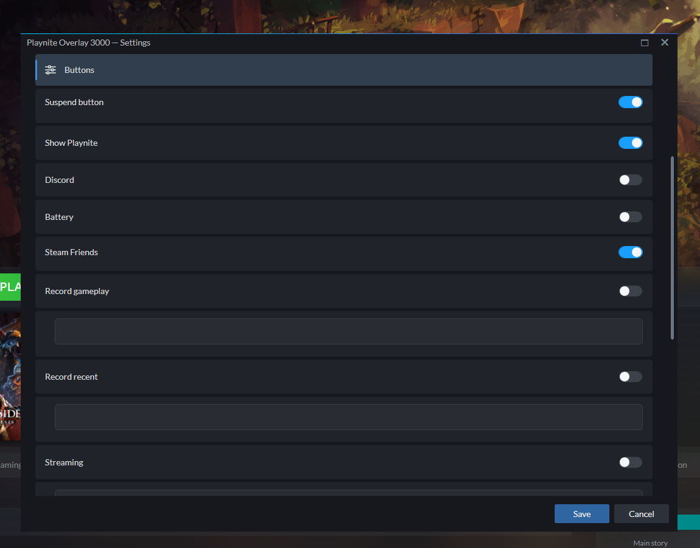

# Playnite Overlay 3000

An in-game overlay for [Playnite](https://playnite.link), usable with keyboard or controller. Open it over any running game to see session info, adjust volume and FPS, check achievements, suspend or close the game, and launch your recording, streaming and chat tools without alt-tabbing.

It also adds a set of quality-of-life tools to Playnite itself: faster game launching, automatic metadata and links, save-folder shortcuts, controller navigation, and a cleaner uninstall.

---

## Screenshots

**In-game overlay**

**Achievements**

**Settings**

| General | Appearance (with live preview) |
| --- | --- |
|  |  |

---

## Features

### In-game overlay

- **Open with keyboard or controller.** Default keyboard shortcut is **Alt + `** (backtick). Default controller shortcut is **View + Menu** (Back + Start), or switch it to the **Xbox / Guide** button, or disable it.
- **Session panel** with playtime for this session and all-time playtime.
- **Achievements panel** showing your unlock progress and the most recently earned achievement, with rarity tiers (Bronze / Silver / Gold) based on how many players have unlocked it. Reads from [PlayniteAchievements](https://github.com/justin-delano/PlayniteAchievements) (preferred) or SuccessStory, auto-detected. Choose a compact **Desktop** or larger **Console** card style. A full achievements window lists every achievement with icon, description, unlock date and rarity, filterable by All / Unlocked / Locked, with earned totals per tier.
- **Sound panel** with volume slider, mute, and output-device switching. Control either **system volume** or **game-only audio volume**.
- **FPS limiter panel** with one-click presets, a custom limit, and sync mode selection (Async, Front Edge, Back Edge, Scanline, Reflex), including scanline target and Reflex marker toggle. Works through RTSS. Needs the [FPS Limiter 3000](https://github.com/pahan3000/fps-limiter-3000) extension.
- **Battery indicator** for laptops and handhelds.
- **Quick-action buttons:** Suspend / Resume, Show Playnite, Exit Game, Discord, Steam Friends, Record gameplay, Record recent, Streaming, Performance overlay, Screenshot gallery, and Web browser. Each one can be pointed at your own shortcut or path, and any can be turned off.
- **Draggable panels** with a "reset panel positions" option.
- **Blurred game artwork background**, with layouts for banner, fill, fit, and stretch, plus adjustable blur and image size. Uses a different layout for exclusive-fullscreen games.
- **Live preview** in the settings so you can see changes as you make them.

### Appearance

- Theme presets: **Steam**, **Steam Dark**, **Windows 11**, **Dynamic (cover accent)**, and **Custom**.
- Custom accent color, panel color, panel opacity, and corner radius.
- Optional glass effect with adjustable strength.
- Adjustable dim level for the game behind the overlay.
- Save your own named appearance presets and reuse them.
- Separate theme for the settings windows themselves (Steam, Steam Dark, Windows 11).

### Game control

- **Suspend / resume** the game while the overlay is open (on by default). Unreal Engine and Easy Anti-Cheat games are never suspended.
- **Close Game behavior:** close window (asking), end task (telling), or close then end task.
- **Alt + F4 force-close** (SuperF4-style): closes the game immediately when enabled.
- **Borderless window mode** for games that start windowed.
- **Force Windows Game Mode** for all games, and register game executables so Windows treats them as games (Game Mode, GPU priority, Game Bar).
- **Run on discrete GPU** per game, from the game's right-click menu.
- **Smarter playtime:** subtract suspended and unfocused time, and ignore short sessions below a minimum you choose.

### Hotkeys

- **Keyboard:** overlay, force-close, suspend / resume, volume up, volume down, mute, game settings window, global settings.
- **Controller combos** (hold the buttons you want, let go to save): overlay, screenshot, suspend, mute, volume up, volume down.
- **PrintScreen remap:** while a game is focused, PrintScreen sends a different key combo, useful for AMD Software or GeForce screenshot hotkeys.
- Every hotkey has a reset button.

### Controller support

- **Desktop controller navigation** in Playnite: move through your library, select with A, go back with B, collapse and expand groups, and use Grid view and the details panel.
- **Gamepad button prompts** with Auto / Xbox / DualShock-DualSense glyphs. Auto picks based on the pad you are using.
- **DualShock 4 and DualSense PS button** detection through HID, since XInput and Steam Input often hide it.
- **Cursor auto-hide** when you use a controller, and it comes back when you move the mouse.

### Instant Play

Skip the storefront launch process (including cloud-save sync and dependency installers) and start the game executable directly.

- Supports **Steam, GOG, Xbox, Epic, and Ubisoft** games.
- Off by default. Turn it on globally, then opt individual games in or out from the right-click menu.
- Keeps Playnite tracking the session until the game exits. Leftover processes are cleaned up after a force-close.
- Keep Steam running in the background for best compatibility. Steam overlay and Steam playtime may be limited.

### Library and metadata automation

- **Local games folder scan:** point it at a folder of non-storefront games, and each game's main `.exe` is detected, added to Playnite, and given metadata. Runs at startup, on library refresh (F5), by hotkey, or from the menu.
- **Automatic metadata** for games you add by hand (cover, description, genres, and more) without overwriting values you already set.
- **Better titles for dropped exes** (Playnite names them after the folder, such as "Win64").
- **Auto-assign the PC platform** to manually added games.
- **Achievements for custom games:** requests them from the Playnite Achievements extension once the game has its name, metadata and links.
- **Install size filler** for games with no size (manual games, emulated games, and library games where the plugin gave none).
- Optional progress dialog while metadata and achievements download.

### Automatic links

Adds useful links to each game's Links list in Playnite:

- **PCGamingWiki** and **Nexus Mods**
- **GameBanana** (only for confident title matches; existing links are kept)
- **Vortex** (opens Vortex)
- **Save and config folders**, using the community [Ludusavi manifest](https://github.com/mtkennerly/ludusavi-manifest) plus fallbacks for emulated games and PC recompilations / unofficial ports
- **SCSKiller** (optional, only for games likely to benefit)

### Complete uninstall

A **Complete uninstall** option in the game menu runs the normal launcher uninstall, then looks for what was left behind: mods, added files, shader cache, workshop data, and Vortex staging or download folders. It shows you exactly what it found and only deletes after you confirm. Symlinks and junctions are removed as links and never followed. Pending cleanups can be rechecked from the main menu.

### Other

- Playnite top-bar button for quick access to game settings.
- Per-game settings window.
- Optional activity log, handy for troubleshooting if Playnite crashes.

---

## Installation

1. Download the latest `.pext` from the [Releases](https://github.com/pahan3000) page.
2. Drag it onto the Playnite window, or double-click it, and confirm.
3. Restart Playnite.
4. Open the settings via **Add-ons → Extensions → Generic → Playnite Overlay 3000**.

### Optional companions

| Extension | Used for |
| --- | --- |
| [PlayniteAchievements](https://github.com/justin-delano/PlayniteAchievements) | Achievement panel (preferred source) |
| SuccessStory | Achievement panel (fallback) |
| [FPS Limiter 3000](https://github.com/pahan3000/fps-limiter-3000) | FPS limiter panel |
| RivaTuner Statistics Server (RTSS) | Frame limiting backend |
| Vortex | Vortex link and mod leftover cleanup |

## Building from source

See [BUILD_AND_PACKAGE.md](BUILD_AND_PACKAGE.md). In short: install Visual Studio 2022 with the .NET desktop workload and the .NET Framework 4.6.2 targeting pack, install Playnite, then run `build-overlay.bat` (or `pack.ps1`). The `.pext` appears in `release\`.

---

## Credits

- **Jonathan Sellier ([jonosellier](https://github.com/jonosellier))**: original author of [PlayniteGameOverlay](https://github.com/jonosellier/PlayniteGameOverlay), which this project is forked from.

**Ideas and inspiration**

- **Special K team and Kaldaien**: the Instant Play idea, the Windows Game Mode and game-registration approach.
- **SKIF**: the model for skipping the platform launch process.
- **SuperF4**: the model for the Alt + F4 force-close.

**Projects and services this extension works with**

- [Playnite](https://playnite.link) by Josef Nemec and the Playnite SDK
- [PlayniteAchievements](https://github.com/justin-delano/PlayniteAchievements) by justin-delano
- [FPS Limiter 3000](https://github.com/pahan3000/fps-limiter-3000) by pahan3000
- [SuccessStory](https://github.com/Lacro59/playnite-successstory-plugin) by Lacro59
- [RivaTuner Statistics Server](https://www.guru3d.com/) (RTSS)
- [Ludusavi manifest](https://github.com/mtkennerly/ludusavi-manifest) by mtkennerly
- [PCGamingWiki](https://www.pcgamingwiki.com), [Nexus Mods](https://www.nexusmods.com), [GameBanana](https://gamebanana.com), and [Vortex](https://www.nexusmods.com/about/vortex/)
- [SCSKiller](https://github.com/BlueHeisenberg/SCSKiller) by BlueHeisenberg

**Libraries**

- [SharpDX](https://github.com/sharpdx/SharpDX) (XInput)
- [SDL2#](https://github.com/flibitijibibo/SDL2-CS) by Ethan "flibitijibibo" Lee (zlib license)
- Microsoft .NET packages (`System.Text.Json` and related)

---

## License

MIT. See [LICENSE.txt](LICENSE.txt). Copyright (c) 2025 Jonathan Sellier, (c) 2026 pahan3000.
